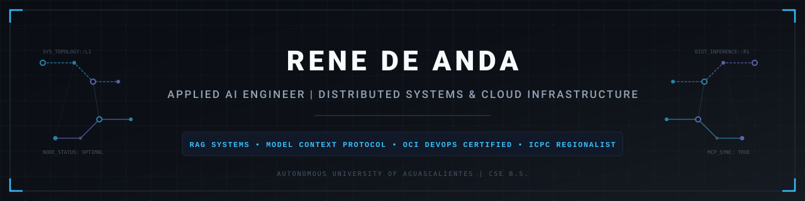

<picture>
  <source media="(prefers-color-scheme: dark)" srcset="assets/banner-dark.svg">
  <source media="(prefers-color-scheme: light)" srcset="assets/banner-light.svg">
  
</picture>

## Executive Summary

Applied AI and Systems Engineer specialized in architecting deterministic agentic systems, enterprise-grade Retrieval-Augmented Generation (RAG) pipelines, and distributed inference topologies. Proven background deploying production microservices and serverless workflows across Oracle Cloud Infrastructure (OCI) and AWS, integrating standard interoperability protocols like Model Context Protocol (MCP), and fine-tuning domain-specific language models. Strong foundation in algorithmic optimization, low-latency architectures, and distributed systems.

---

## Core Technical Competencies

### Languages

### AI & Agentic Systems

### Cloud, DevOps & Infrastructure

### Frameworks & Storage

---

## Highlighted Engineering Projects & Research

| Project | Domain | Architecture & Technical Highlights |
| :--- | :--- | :--- |
| **Enterprise Agentic Workflows** | MCP & Distributed Context | Architected custom Model Context Protocol (MCP) servers and stateful agents via LangGraph and Spring Boot. Facilitated dynamic context retrieval, structured tool execution, and deterministic agent handoffs. |
| **On-Premise LLM Engine** | Private High-Throughput Inference | Engineered air-gapped LLM inference runtime utilizing vLLM and Ollama. Implemented dynamic batching and PagedAttention mechanisms to serve localized RAG pipelines with strict data governance. |
| **AI Tutor for Education** | Parameter-Efficient LLM Fine-Tuning | Applied LoRA adaptation on open-weights language models combined with vector search indexation to provide contextual error diagnosis, code trace explanation, and real-time guidance for CSE curricula. |
| **Supply Chain Scheduling Modules** | Enterprise Web Applications | Developed high-performance scheduling and optimization interfaces using React and Python backend services, enabling granular operational tracking at scale. |

---

## Competitive Programming & Certifications

- **ICPC Mexico Regional Contestant** (2025) - Competitive programmer focusing on graph algorithms, dynamic programming, and computational geometry under strict resource constraints.
- **Oracle Certified Associate / Professional**: OCI 2025 Certified DevOps Professional (`1Z0-1109-25`).
- **AWS Academy Graduate**: AWS Academy Cloud Foundations.
- **EPAM Systems**: NextGen Cloud & DevOps Program.
- **B.S. in Computer Systems Engineering**: Autonomous University of Aguascalientes (GPA: 3.7 / 4.0).

---

## GitHub & System Metrics

  <table border="0">
    <tr>
      <td>
        
      </td>
      <td>
        
      </td>
    </tr>
  </table>

---

## Professional Coordinates

- **LinkedIn**: [linkedin.com/in/renedeanda](https://www.linkedin.com/in/renedeanda)
- **GitHub**: [github.com/starcrash16](https://github.com/starcrash16)
- **Email**: [rene.deanda.m@gmail.com](mailto:rene.deanda.m@gmail.com)
